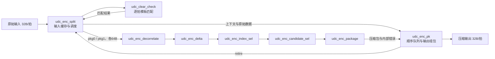
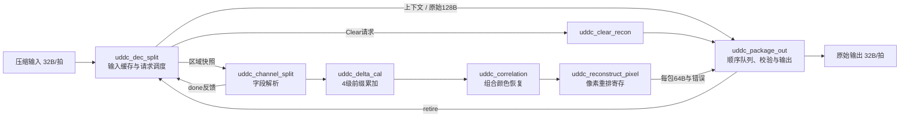

# UDC / UDDC 微架构、接口、性能与错误处理

本文对照 RTL 基线 `b732757` 编写，记录当前实现。算法字段定义以
[DicAlgo.html](../DicAlgo.html) 为参考；目标、RTL 行为和已验证范围分别标注。
本文不改变硬件功能或接口。

## 1. 数据单位与通用协议

先约定文中变量和计量单位：

| 名称 | 含义 |
| --- | --- |
| unit | 一个完整数据单元，原始数据为 1024bit / 128B |
| pkg0 / pkg1 | DIC 的两个压缩包，各恢复出 512bit / 64B |
| slot / unit_id | unit 的缓存位置及其在各级流水线中的关联编号 |
| beat | 外部一次 256bit / 32B 传输；按成功握手计数 |
| `UNIT_ID_W` / `UNIT_SLOTS` | 编号宽度 / 在途 unit 容量，默认分别为 4 / 8 |
| `valid && ready` | 一次传输被接收，本文记作“握手” |
| `retire_valid` | unit 最后一拍最终输出握手，释放其 slot |

所有模块使用同一时钟，`rst_n` 为低有效复位。复位清除有效位、占用位、
指针和控制状态；多数数据寄存器不清零，其内容只能在对应有效条件成立时使用。
复位会丢弃在途 unit，不提供部分事务恢复或跨时钟域功能。

外部源必须在 `valid=1 && ready=0` 时保持载荷和边带稳定，直到握手。
输出使用同一约定。`valid=0` 时，数据、SOP、LAST、错误等载荷不表示有效事务。
上游可以插入空拍；下游可以反压。反压只允许延长时间，不改变包内拍顺序。

编码输入固定四拍，SOP 只在第 0 拍，LAST 只在第 3 拍。
编码端在第一拍采样格式与尺寸限制。压缩流的 CBMD 也只在第一拍有效，
解码端在第一拍保存，后续拍使用保存值。

| CBMD | 类型 | 有效载荷 | 输入/编码输出传输次数 | 包尺寸条件，`a=size0, b=size1` |
| --- | --- | ---: | ---: | --- |
| 0 | 原始 | 128B | 4 | 不解析 DIC |
| 1 | DIC | 32B | 1 | `a>0, b>0, a+b<=32` |
| 2 | DIC | 64B | 2 | `32<a+b<=64, a<=32, b<=32` |
| 3 | DIC | 64B | 2 | `32<a+b<=64, a<32, b>32` |
| 4 | DIC | 64B | 2 | `32<a+b<=64, b<32, a>32` |
| 5 | DIC | 96B | 3 | `64<a+b<=96` |
| 6～15 | Clear | 0B | 1 次控制传输 | 模板索引为 `CBMD-6` |

Clear 传输必须 `has_data=0, sop=1, last=1`。其他模式必须 `has_data=1`。
解码输出始终为四拍 32B，包含 Clear 和错误 unit。

## 2. 顶层与数据路径

### 2.1 编码器 `udc_enc_core`



`udc_dic_enc` 包装图中的五个 DIC 处理模块，本身不增加寄存级。
编码器保留原始数据，只有两个包都成功且满足尺寸限制才选择 DIC；否则输出原始模式。
Clear 命中优先于 DIC 和尺寸限制为零的原始旁路。

### 2.2 解码器 `uddc_dec_core`



`uddc_dic_dec` 包装解析、累加、颜色恢复与像素重排，本身不增加寄存级。
原始路径和 Clear 路径绕过 DIC 算术流水线，但最终都按上下文顺序输出。

## 3. FIFO、slot 与缓存

这里没有通用 FIFO IP。顺序 FIFO 由 `order_mem + head + tail + count` 实现，
数据缓存用 slot 编址，流水级间用单项弹性寄存器解耦。数组声明不等于已经实现 SRAM，
实际存储器或触发器映射由综合决定。

| 位置 | 容量/主要载荷 | 写入与读取规则 |
| --- | --- | --- |
| 编码 `udc_enc_split.raw_mem` | `UNIT_SLOTS × 1024bit`，默认 1KiB | 四拍写入，收齐且模板判断完成后调度；保留至 retire 后可重用 |
| 编码 Clear 请求寄存器 | 1 项，256bit 数据及 unit_id/SOP/LAST | 每个输入握手装入；旧请求被接受时可同拍替换 |
| `udc_clear_check` | 10bit 累积匹配位；1 项响应寄存器 | 每拍取交集；最后一拍产生 hit/index/unit_id |
| 编码 `udc_enc_pk` 顺序 FIFO | `UNIT_SLOTS × UNIT_ID_W`，默认 32bit 编号存储 | 上下文握手入队，最终输出 LAST 握手出队 |
| 编码 `udc_enc_pk` 数据缓存 | 每 slot 原始 1024bit、两份 544bit 压缩包，以及尺寸、格式、限制、done/error 和 Clear 元数据 | 按 unit_id 收结果，只检查并输出队首 |
| 解码 `uddc_dec_split.data_mem` | `UNIT_SLOTS × 1024bit`，默认 1KiB | 按拍写入；DIC 只使用低 768bit，原始模式使用全部 1024bit |
| 解码请求寄存器 `pkg_*` | 1 项，768bit 区域及 unit_id/pkg_id/CBMD/有效字节数/final | 保存一份可重试快照；后级停顿时保持稳定 |
| 解码 `uddc_package_out` 顺序 FIFO | `UNIT_SLOTS × UNIT_ID_W` | 上下文握手入队，第四拍输出握手出队 |
| 解码 `uddc_package_out` 结果缓存 | 每 slot 1024bit 数据，两个包的 done/error/format/size 及模式 | 按 unit_id/pkg_id 写半个 unit；两包齐全并校验后输出 |
| `uddc_clear_recon` | 1 项，1024bit 恢复数据与 unit_id | 接收索引后寄存 `{8{pattern}}`，支持反压 |

两端输出 FIFO 的变量含义相同：`head` 为队首位置，`tail` 为下次写入位置，
`count` 为已接收上下文但尚未输出完毕的 unit 数量，`live[id]` 防止重复建立上下文。
`count` 在同时入队/出队时不变。FIFO 满时，即使本拍出队，当前实现也不会提前放行入队。
队首尚未就绪时，后面的已完成 unit 不能越过队首。

输入侧 `allocated[id]` 在第一拍置位，在 retire 时清除。`wr_slot` 在输入收齐后前进，
`dispatch_slot` 在请求调度结束后前进，这两者都不等于释放 slot。
解码侧 `started[id]` 表示上下文尚待交付，`complete[id]` 表示输入已收齐且调度未结束。

两端写指针都按环形顺序分配，不搜索任意空闲项。`s_ready` 不旁路同拍的 retire，
所以回到占用 slot 时，最早在释放后的下一拍继续接收。
默认 8 slot 是容量配置，不是 DIC 算法要求；4 slot 的解码边界与混合流已做定向验证，
但不构成任意模式切换都无空拍的保证。

## 4. FSM 与流水线

### 4.1 输入调度 FSM

两个调度器均采用三段式：状态寄存、次态组合逻辑、按变量拆分的输出逻辑。

| 模块/状态 | 行为 | 跳转条件 |
| --- | --- | --- |
| 编码 CTX | 等待四拍收齐和 Clear 响应，再提交上下文 | Clear 命中或 limit=0：保持 CTX 并前进到下一个 unit；否则转 PKG0 |
| 编码 PKG0 | 发送原始低 512bit | 请求握手后转 PKG1 |
| 编码 PKG1 | 发送原始高 512bit | 请求握手后回 CTX，调度指针前进 |
| 解码 CTX | 提交上下文；DIC 可用第一拍旁路，原始模式必须收齐 | 原始：保持 CTX 并前进；DIC：转 PKG0；Clear：转 CLEAR |
| 解码 PKG0 | 随有效数据增加提供更长快照 | 请求握手且 done=1 后转 PKG1 |
| 解码 PKG1 | 等完整区域到齐，提供反向布局的 pkg1 | 请求握手且 done=1 后回 CTX，调度指针前进 |
| 解码 CLEAR | 发送模板索引 | 请求握手后回 CTX，调度指针前进 |

编码的 `pending_decor` 与候选选择的 `waiting` 是额外的局部控制位：
前者表示还欠一个颜色变换候选，后者表示原始候选已保存、等待对应变换候选。
输出序列化使用 `beat` 计数器，不另设一套命名状态机。

### 4.2 编码 DIC 流水线

| 级/模块 | 组合工作 | 寄存与吞吐 |
| --- | --- | --- |
| E0 `udc_enc_decorrelate` | 像素转通道平面；对可变换格式计算颜色差分 | 输出 1 项；可变换格式另保存 1 份待发候选，依次输出原始/变换两份 |
| E1 `udc_enc_delta` | 提取锚点，按预测关系计算差分 | 输出 1 项，可接收 1 候选/拍 |
| E2 `udc_enc_index_sel` | 选择通道/成对宽度策略，计算索引和逻辑长度 | 输出 1 项，可接收 1 候选/拍 |
| E3 `udc_enc_candidate_sel` | 比较原始与变换候选长度 | 保存 1 份原始候选，输出 1 项；相等时选原始候选 |
| E4 `udc_enc_package` | 生成头、策略、索引、锚点与差分位流，检查长度 | 输出 1 项，含 size/bits/error |

可颜色变换的格式为 4、5、9、10、11。它们每个包产生两个候选，因此 E0 接收新包的
间隔至少两拍；其他格式可每拍接收一个包。每 unit 两个包，双候选路径的包处理能力
对应每四拍一个 unit，与外部原始数据输入速率匹配，具体 slot 配置仍需验证。
从包请求握手到包结果握手，无停顿时普通格式为 5 周期，双候选格式为 6 周期。

各弹性输出的通用控制为 `s_ready = !m_valid || m_ready`：空寄存器可装入，
满寄存器可在旧结果被接受时同拍替换；E0 还受 `!pending_decor` 限制。
这些 ready 路径是组合逻辑，不能把当前实现理解为每级均有独立的注册式反压缓冲。

### 4.3 解码 DIC 流水线

| 级/模块 | 组合工作 | 有效载荷寄存容量 |
| --- | --- | --- |
| 请求寄存器，位于 `uddc_dec_split` | 缓存视图与当前输入转发，选择包号 | 1 份区域快照 |
| D0 `uddc_channel_split` | 动态字段提取、索引展开、差分符号扩展 | 1 个完整解析结果；不完整快照不产生结果 |
| D1 `uddc_delta_cal` stage 0 | 距离 1 的前缀累加 | 1 个包 |
| D2 stage 1 | 距离 2 的前缀累加 | 1 个包 |
| D3 stage 2 | 距离 4 的前缀累加 | 1 个包 |
| D4 stage 3 | 距离 8 的前缀累加 | 1 个包 |
| D4 到 D5 间的组合路径 | 加锚点，`uddc_correlation` 颜色恢复，像素重排 | 中间无额外数据寄存器 |
| D5 `uddc_reconstruct_pixel` | 捕获重排后的 512bit 原始包及错误 | 1 个包 |

包请求被接受后，到包结果被输出缓存接受，无停顿时为 6 周期。
四级累加都做实际运算，没有单纯复制差分的额外输入级。
通道加法按通道位宽取模，溢出回绕属于算法行为，不产生错误。

`uddc_correlation` 单独实例化时默认 `REGISTER_OUTPUT=1`，有一个弹性输出寄存级；
当前 `uddc_dic_dec` 显式设为 0，采用组合模式。不能按模块数量直接计算寄存级数。

解析器每次重新解析整个快照，不保存半包的已解析字段。
pkg0 从占用区域低端开始，pkg1 从占用区域高端开始，后者因此等完整区域收齐后调度。
差分流水线可接收 1 包/拍，但整机输出仍受每 unit 四拍的序列化约束。

解码输出缓存将本拍接受的最后一个包同时纳入队首数据、完成位、格式、尺寸和错误判断，
允许首拍输出与最后一个包的写缓存同拍握手。发生输出反压时，同一份包仍会写入缓存，
随后由缓存保持数据和错误状态，避免转发结束后输出变化。

## 5. 子模块间接口

### 5.1 顶层接口

| 顶层 | 输入载荷 | 输出载荷 |
| --- | --- | --- |
| `udc_enc_core` | `s_data[255:0], s_sop, s_last, s_udc_format[3:0], s_package_size_limit[6:0]` | `m_data[255:0], m_sop, m_last, m_has_data, m_cbmd[3:0]` |
| `uddc_dec_core` | `s_data[255:0], s_sop, s_last, s_has_data, s_cbmd[3:0]` | `m_data[255:0], m_sop, m_last, m_error` |

两端另有 `s_valid/s_ready`、`m_valid/m_ready` 和 `cfg_clear_pattern[9:0][127:0]`。
Clear 配置没有更新握手或版本号；编码匹配期间必须保持稳定，并由系统保证解码时的
模板与编码时一致。模板不同导致的数据错误没有额外硬件检测。

`s_package_size_limit` 以字节计，约束每个压缩包；大于 68 的输入会截为 68，
零表示跳过 DIC。它不是一个 unit 的压缩总长限制，也不会禁止 Clear。

### 5.2 编码器内部接口

下表每条数据通路都由其 `valid/ready` 完成握手；编号宽度为 `UNIT_ID_W`。

| 生产者 → 消费者 | 信号/载荷 | 事务含义 |
| --- | --- | --- |
| split → clear_check | `clear_req_*`：unit_id、SOP、LAST、data[255:0] | 每个输入拍的注册副本 |
| clear_check → split | `clear_rsp_*`：unit_id、hit、index[3:0] | 一个 unit 最后一拍比较后的匹配结果 |
| split → enc_pk | `ctx_*`：unit_id、fmt[3:0]、limit[6:0]、clear_hit、clear_index[3:0]、raw[1023:0] | 建立输出顺序、保存原始回退数据 |
| split → dic_enc | `pkg_*`：unit_id、pkg_id、fmt[3:0]、raw[511:0] | 请求压缩半个 unit |
| decorrelate → delta | `a_*`：unit_id、pkg_id、fmt[3:0]、decor、planes[511:0] | 一份候选的通道平面 |
| delta → index_sel | `b_*`：编号/格式/decor、anchors[3:0][31:0]、deltas[511:0] | 候选锚点与差分 |
| index_sel → candidate_sel | `c_*`：上一行载荷，加 strategy[3:0]、indexes[31:0][4:0]、logical_bits[9:0] | 编码策略与候选长度 |
| candidate_sel → package | `d_*`，字段同 `c_*` | 每个包最终选中的一份候选 |
| dic_enc → enc_pk | 顶层名 `result_*`：unit_id、pkg_id、fmt[3:0]、size_bytes[6:0]、bits[543:0]、error | 压缩包结果，包内排列方向由 pkg_id 决定 |
| enc_pk → split | `retire_valid, retire_unit_id`，无 ready | 最后一拍压缩输出握手，释放 slot |

### 5.3 解码器内部接口

| 生产者 → 消费者 | 信号/载荷 | 事务含义 |
| --- | --- | --- |
| split → package_out | `ctx_*`：unit_id、cbmd[3:0]、raw[1023:0] | 建立顺序；raw 仅原始模式有效 |
| split → dic_dec | 顶层名 `req_*`：unit_id、pkg_id、cbmd[3:0]、region[767:0]、available_bytes[6:0]、final | 可重试的区域快照；字节数不是当前包大小 |
| dic_dec → split | `req_done`，模块端口名 `s_done/pkg_done` | 当前快照足以结束包解析；仅在请求握手时采样 |
| channel_split → delta_cal | `a_*`：unit_id、pkg_id、fmt[3:0]、decor、anchors[3:0][31:0]、deltas[511:0]、size_bytes[6:0]、error | 完整解析结果或最终错误结果 |
| delta_cal → correlation | `b_*`：编号/格式/decor、planes[511:0]、size_bytes[6:0]、error | 加锚点后的通道平面 |
| correlation → reconstruct_pixel | `c_*`，字段同 `b_*` | 颜色恢复后的平面；当前是组合连接 |
| dic_dec → package_out | `result_*`：unit_id、pkg_id、fmt[3:0]、raw[511:0]、size_bytes[6:0]、error | 恢复的半个 unit |
| split → clear_recon | `clear_req_*`：unit_id、index[3:0] | 选择 0～9 号模板 |
| clear_recon → package_out | `clear_rsp_*`：unit_id、raw[1023:0] | 16B 模板重复八次的结果 |
| package_out → split | `retire_valid, retire_unit_id`，无 ready | 第四拍原始输出握手，释放 slot |

`req_done=0` 不表示请求未被接收。例如 32B 快照握手后解析器仍可认为字节不足，
不输出结果；split 仅在有更多字节时提交更长快照。`req_done=1` 表示解析成功或最终错误，
不表示差分恢复和最终输出已经结束。

当前输入转发使本拍到达的数据直接进入下一份请求寄存器，不必等缓存写完再读。
`req_done` 是组合解析反馈，因此从字段解析到下一份请求选择存在组合时序路径。

## 6. 性能目标与当前结果

### 6.1 目标及验收口径

| 项目 | 目标/约束 | 当前证据 |
| --- | --- | --- |
| 工艺与时钟 | TSMC7，1.5GHz，周期 `2/3 ns` | 设计目标；尚无真实工艺角完整核心 STA 签核 |
| 编码原始输入 | 持续 32B/拍，即 1 unit / 4 拍 | RTL 结构支持；默认 8 slot 的定向性能检查见验证说明 |
| 解码原始输出 | 预热后持续 32B/拍，即 1 unit / 4 拍；允许输入反压 | 4 slot 的指定连续工作负载已通过；不保证任意模式切换均连续 |
| 外部峰值带宽 | 按 1.5GHz 目标折算为每方向 48GB/s（十进制） | 理论 `32B × 1.5GHz`，不是实测硅带宽 |
| 解码首拍延迟 | 无排队/停顿时 DIC 为 8～10 周期；原始 5、Clear 4 | 当前 RTL 周期仿真值，条件见下表 |

编码输出是变长数据，即便原始输入连续，也可能因压缩而出现正常空拍。
解码输入为压缩数据，长期可接受带宽受解压输出约束：模式 1/2～4/5 每四个输出周期
分别只需 1/2/3 拍有效压缩输入；Clear 需要一次控制传输。任何有限 slot 数都无法让
模式 1 的输入以 1 unit/拍长期进入，同时只以 1 unit/4拍输出；必须反压。

延迟定义：第一拍输入握手的时钟沿为 T0，首拍输出握手发生于 TN，延迟为 N 周期。
“当前值”假设无先前排队、输入所需各拍连续、下游 ready 恒为 1；有等待时延迟可增加，
无限反压或无限输入空拍下无有限的最大延迟承诺。

| 解码工作负载 | 首拍输出 | 末拍输出 | 按目标时钟折算的首拍时间 |
| --- | ---: | ---: | ---: |
| 原始 CBMD0，四拍输入 | T5 | T8 | 3.333ns |
| Clear，单次控制传输 | T4 | T7 | 2.667ns |
| 单扇区 DIC，CBMD1 | T8 | T11 | 5.333ns |
| 三扇区 DIC，pkg0=64B/pkg1=20B | T9 | T12 | 6.000ns |
| 三扇区 DIC，pkg0>64B | T10 | T13 | 6.667ns |
| 三扇区 DIC，pkg0 头错误，等待最终快照 | T10 | T13 | 6.667ns |

时间列只是周期数乘以目标周期，不证明该 RTL 已满足 1.5GHz。
编码器无排队、无反压的当前首拍延迟：Clear 或 limit=0 为 T7，普通格式 DIC 为 T14，
双候选格式 DIC 为 T16。末拍取决于输出 CBMD，占用 1～4 拍；Clear 为一次控制输出。
若实际选择原始回退且执行过 DIC，则仍需等待两个 DIC 结果，不能套用 limit=0 的 T7。

### 6.2 最长的上述 DIC 路径：pkg0 超过 64B

| 时钟沿 | 输入与调度 | pkg0 | pkg1 |
| --- | --- | --- | --- |
| T0 | 接收前 32B；旁路上下文；寄存第一份快照 | — | — |
| T1 | 接收累计 64B；寄存 64B 快照 | 尝试解析 32B，不足 | — |
| T2 | 接收累计 96B；寄存最终快照 | 尝试解析 64B，不足 | — |
| T3 | 直接替换为 pkg1 请求 | 最终快照解析并寄存 | — |
| T4 | 请求调度结束，允许转到下一 unit | 距离 1 累加寄存 | 解析并寄存 |
| T5 | 后续 unit 可继续流水处理 | 距离 2 累加寄存 | 距离 1 累加寄存 |
| T6 | 同上 | 距离 4 累加寄存 | 距离 2 累加寄存 |
| T7 | 同上 | 距离 8 累加寄存 | 距离 4 累加寄存 |
| T8 | 同上 | 加锚点、颜色恢复、像素重排后寄存 | 距离 8 累加寄存 |
| T9 | 同上 | 写输出缓存 | 加锚点、颜色恢复、像素重排后寄存 |
| T10 | 输出第 1 拍 | 最终包同时参与校验与数据转发 | 同拍写输出缓存 |
| T11～T13 | 输出第 2～4 拍，T13 retire | — | — |

这是无阻塞条件下列出的最长输入依赖路径，不是含任意队列等待的绝对上界。

### 6.3 连续输出边界与频率验证缺口

现有四 slot 回归检查了 64B/20B、20B/64B、短包、超过 64B 的包以及指定混合流。
这些连续测试从第一拍输出起要求没有后续空拍，已通过。
Clear 开头随后接 64B/20B DIC 的测试仍有三拍空拍：Clear 很快开始输出，后面的 DIC
尚未完成流水线。当前没有统一预填充策略，不能声称“只要输入连续就始终输出连续”。
若验收条件是首拍输出后任意模式切换都不得出现空拍，则当前实现尚未完成这一目标。

需要真实 TSMC7 库进一步检查的路径包括：动态格式和字段提取 mux、解析 done 反馈、
各级前缀加法、加锚点到颜色恢复/像素重排、最后一个包到输出的转发校验，以及组合 ready 链。
现有 [加法树比较](../synthesis/adder_tree_compare/README.md) 仅为 Nangate45 的固定格式
算术实验，未包含上述完整控制和数据通路，不能用于 TSMC7 整机通过/失败结论。
编码端还需检查颜色变换、宽度策略选择、动态位流组包和最终模式选择到输出的路径。

## 7. 格式支持与错误可见性

### 7.1 支持的 DIC 格式

格式编号在当前 RTL 中为 1～14。下表按通道顺序列出位宽和每包样本数，
用于说明硬件布局，不额外假设上层像素格式名称。

| 格式 | 通道位宽 | 每通道样本数 | 尝试颜色变换 |
| --- | --- | --- | --- |
| 1 | 8 | 64 | 否 |
| 2 | 16 | 32 | 否 |
| 3 | 32 | 16 | 否 |
| 4 | 16/16/16/16 | 8/8/8/8 | 是 |
| 5 | 32/32/32/32 | 4/4/4/4 | 是 |
| 6 | 8/8 | 32/32 | 否 |
| 7 | 16/16 | 16/16 | 否 |
| 8 | 24/8 | 16/16 | 否 |
| 9 | 11/11/10 | 16/16/16 | 是 |
| 10 | 8/8/8/8 | 16/16/16/16 | 是 |
| 11 | 10/10/10/2 | 16/16/16/16 | 是 |
| 12 | 32/32 | 8/8 | 否 |
| 13 | 32/8/24 | 8/8/8 | 否 |
| 14 | 32/32/32 | 6/5/5 | 否 |

### 7.2 不支持格式时是否报错

**编码器 UDC 顶层当前不报错。** `udc_enc_split` 将 `s_udc_format=0/15` 映射成 10，
继续模板匹配和压缩；它不会因为原始输入格式无效就强制输出原始模式。
即便内部 package 模块能检测非法格式，顶层映射也会先把 0/15 转成合法的 10。
因此不得将内部 `result_error` 解释为对外的“不支持格式”告警。

**解码器 UDDC 对 DIC 包头格式 0/15 报错。** `channels(fmt)==0` 使解析失败；
非最终快照暂不交付结果，最终快照交付 error，经流水线传到输出缓存。
待两个包结果收齐后，整个 unit 输出四拍全零、每拍 `m_error=1`。

若接口要求“UDC 收到不支持格式必须显式告警”，当前实现尚不满足：需要约定新的
错误输出或状态接口及处理策略，本文只记录已有行为，不添加接口。

### 7.3 UDC 内部错误及原始回退条件

`udc_enc_package` 的 `m_error` 仅在内部使用。任一条件成立时，将包 bits 和 size 清零，
并随 unit_id/pkg_id 输出错误结果：

| 条件 | 检测位置 |
| --- | --- |
| 格式无有效通道；计算出的字节数为 0 或大于 68 | `channels(fmt)`、`bytes` 初始检查 |
| 索引超出索引字段位宽，或 `decode_width(index,width)<0` | 索引组装 |
| 字段长度非法、超过 512bit，或落到 544bit 包缓存范围之外 | `put_field()` |
| 差分宽度非法，或某通道差分载荷超过 512bit | 差分组装 |
| 实际组装的逻辑 bit 数与 `s_logical_bits` 不一致 | 末尾长度一致性检查 |

`udc_enc_pk` 只有在以下条件全部满足时才选择 DIC：两个包都完成、内部错误均为零、
两包格式均与上下文一致、两包尺寸均大于零、均不超过本 unit 的 limit 和 68B、总和不超过 96B。
任一条件不满足时输出原始 128B，`CBMD=0`。`limit=0` 直接跳过 DIC，属于显式旁路。
这些回退没有对外错误码、中断或错误计数器。

### 7.4 UDDC 硬件错误条件

| 条件 | 检测位置 | 处理 |
| --- | --- | --- |
| 解析器收到非 DIC 的 CBMD | `uddc_channel_split` 初始检查 | 内部解析错误；正常顶层调度不会把原始/Clear 送入解析器 |
| 包头两位保留字段非零 | 头部解析 | 包错误 |
| 包头格式不是 1～14 | `channels(fmt)==0` | 包错误 |
| 任一字段越过当前可用字节或占用区域边界，字段长度非法 | `take_field()` | 非最终快照等待更多数据；最终快照产生包错误 |
| 宽度索引无法解码成合法通道差分宽度 | `decode_width()` | 包错误 |
| 使用 bit 数为零、超出区域或算出的包位置越界 | 解析末尾检查 | 包错误 |
| 任一个包携带 error | 输出缓存的 `head_package_errors` | unit 错误 |
| 两个包的格式不同 | 输出缓存格式比较 | unit 错误 |
| 两个包尺寸不满足 CBMD 对应关系 | `valid_sizes()`，见第 1 节表格 | unit 错误 |

解析器的完成条件是 `!next_error || s_final`，只有请求握手时才构成完成事件。
不完整前缀和已经能发现的坏头，在 final 到来前都不会单独对外报错。
输出模块等待两个包都完成后才决定整个 unit 的错误，避免先输出半个正常 unit 再发现后半错误。

unit 错误时 `m_data=0`、`m_error=1`，SOP/LAST 仍正常形成四拍输出；下游反压时保持稳定。
错误 unit 在最后一拍握手后正常 retire，后续 unit 继续按序处理。
顶层只有一个错误位，没有区分格式、边界、索引或尺寸错误的原因码。

当前解码 `valid_sizes()` **没有单独执行 `a<=68 && b<=68` 检查**，只执行表中的正数、
总长和 CBMD 分布关系。编码端的 68B 限制不能据此写成解码端已有的硬件错误条件。

### 7.5 仿真断言与不覆盖的错误

以下断言位于 `synthesis translate_off` 范围内。它们会报告仿真错误，
不会生成硬件错误输出，也不保证在错误输入之后自动重新同步。

| 断言 | 触发条件 |
| --- | --- |
| `Invalid slots` | `UNIT_SLOTS<=0` 或超过 `2**UNIT_ID_W`，编码/解码输入与输出缓存均检查 |
| `Raw input framing` | 编码输入握手时 SOP/LAST 与固定四拍位置不符 |
| `Illegal encoder dispatch state` | 编码调度状态不是 CTX/PKG0/PKG1 |
| `Multiple clear patterns matched` | Clear 最后一拍握手时，多个模板同时完整匹配；当前索引选择最低编号 |
| `Candidate order/tag mismatch` | 变换候选到达时没有对应原始候选，或 unit_id/pkg_id 不一致 |
| `Unknown decoder dispatch state` | 解码状态中存在未知值；四种二进制编码均有合法状态 |
| `Compressed SOP` | 解码输入握手时 SOP 不等于 `!collecting` |
| `Clear framing` | Clear 有载荷、没有 LAST，或被作为多拍 unit 的后续拍 |
| `Missing compressed data` | 原始/DIC 输入握手时 `s_has_data=0` |
| `Compressed LAST` | 原始/DIC 的 LAST 与 CBMD 对应的拍数不一致 |

当前没有 CRC/ECC 或完整数据内容校验；合法码字被翻转为另一合法码字时可能无法发现。
不适用格式中的 decor 位会被屏蔽，不单独报错。填充字节和字节内 padding 不做一致性校验。
Clear 模板不一致、直接使用 Clear 子模块时索引大于 9、内部非法/重复 tag 等也没有统一的
对外错误报告；部分非法 tag 会因 ready 条件不满足而停住，不能等同于产生 `m_error`。
`uddc_clear_recon` 对直接输入的越界索引输出零；正常顶层由 CBMD-6 产生的索引始终为 0～9。

## 8. 验证与复现

现有解码回归入口为：

```bash
bash tests/run_uddc.sh
UDDC_TEST_SLOTS=8 bash tests/run_uddc.sh
python3 tests/check_rtl_style.py
```

依赖 Python 3、Verilator、C++20 编译器；风格检查另需 `pyslang==12.1.0`。
构建目录在 checkout 外，可设置 `UDDC_TEST_BUILD_DIR` 复用构建，`UDDC_TEST_JOBS` 控制并行数。

默认四 slot 回归含 908 个随机/格式覆盖 unit，以及 1666 个定向延迟/连续性 unit，
合计 2574 个 unit、10296 拍输出。另有调度器独立测试和输出转发独立测试。
覆盖数据、错误、顺序、SOP/LAST、反压稳定性，以及指定工作负载的首拍周期和空拍数量。
原始/Clear 单独启动的 T5/T4 延迟亦可用同一 decoder 测试程序检查。

文档核对期间另做了一次性定向仿真，未计入上述 2574 个常规回归 unit：

| 检查 | 配置和刺激 | 结果 |
| --- | --- | --- |
| 编码首拍与输入吞吐 | 默认 8 slot；格式 1～14、非法格式 0/15、limit=0、Clear，共 18 组，每组连续 128 unit；ready 恒 1 | 共 2304 unit 通过；每组 512 拍输入均无反压，T511 接收最后一拍；首拍分别符合 T14/T16/T7 |
| 编码非法格式映射 | 0/15 两组使用全零输入、非零且不同的 Clear 模板 | 实际输出 DIC 包头格式均为 10 |
| 解码原始/Clear 延迟 | 4 slot；原始单 unit、Clear 单 unit | 分别 T5/T4 首拍输出，数据与边带通过 |
| 解码非法格式 | 分别将 pkg0 或 pkg1 格式改为 0/15，共 4 unit | 均输出四拍全零，error=1 |
| 解码没有单包 68B 上限检查 | 合法字段布局，CBMD5，pkg0=77B、pkg1=14B，共 1 unit | T10 首拍，error=0，与 `valid_sizes()` 的实际条件一致 |

编码 DIC 性能检查采用全零数据，Clear 用第 0 号模板重复形成输入；
它验证这些刺激下的调度吞吐、首拍延迟及包头选择，不替代全数据范围编码功能验证。
上述一次性检查复用当前 RTL、Verilator 和现有解码参考向量/比对程序；
常规回归脚本当前未包含这些新增刺激，因此不将其描述为持续回归覆盖。

现有错误定向覆盖包括保留头错误、包 error、两包格式不一致及非法尺寸；
不能把这些测试解释为已穷举第 7 节全部硬件错误条件或所有协议违规恢复行为。
周期仿真不替代综合、STA、布局布线或硅验证。详细向量说明见
[tests/README.md](../tests/README.md)。

主要条件可追溯到：编码格式映射与限制截断在
[`udc_enc_split.sv`](../rtl/udc_enc_split.sv)，编码包内部错误在
[`udc_enc_package.sv`](../rtl/udc_enc_package.sv)，原始回退在
[`udc_enc_pk.sv`](../rtl/udc_enc_pk.sv)，解码字段错误在
[`uddc_channel_split.sv`](../rtl/uddc_channel_split.sv)，解码 unit 错误及尺寸校验在
[`uddc_package_out.sv`](../rtl/uddc_package_out.sv)。
