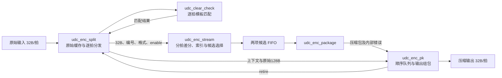
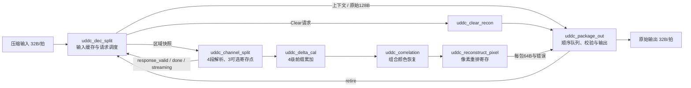

# UDC / UDDC 微架构、接口、性能与错误处理

本文描述当前 RTL：UDC 采用 32B 分拍编码，UDDC 采用连续前缀解析和三个默认开启的
可选寄存点。逐拍细节分别见 [UDC 分拍编码](UDC_STREAMING.md) 和
[UDDC 解析流水](UDDC_PARSER_PIPELINE.md)，解析器的逐函数说明见
[channel_split 模块详解](UDDC_CHANNEL_SPLIT.md)。算法字段以
[DicAlgo.html](../DicAlgo.html) 为参考；工艺目标、周期行为及验证条件分别标明。
外部核心接口保持兼容，新增握手信号仅用于解码子模块之间。

## 1. 数据单位与通用协议

先约定文中变量和计量单位：

| 名称 | 含义 |
| --- | --- |
| unit | 一个完整数据单元，原始数据为 1024bit / 128B |
| pkg0 / pkg1 | DIC 的两个压缩包，各恢复出 512bit / 64B |
| slot / unit_id | unit 的缓存位置及其在各级流水线中的关联编号 |
| beat | 外部一次 256bit / 32B 传输；按成功握手计数 |
| `UNIT_ID_W` / `UNIT_SLOTS` | 编号宽度 / 在途 unit 容量，默认分别为 4 / 8 |
| `valid && ready` | 一次传输被接收，本文记作“握手” |
| `retire_valid` | unit 最后一拍最终输出握手，释放其 slot |

上下游及所有子模块使用同一时钟和低有效复位 `rst_n`。复位期间不进行有效传输，
即使 `valid && ready` 为高也不计为握手；组合逻辑不直接用复位信号屏蔽接口。
以下握手和反压保持约定均适用于复位释放后。复位清除有效位、占用位、
指针和控制状态；多数数据寄存器不清零，其内容只能在对应有效条件成立时使用。
复位会丢弃在途 unit，不提供部分事务恢复或跨时钟域功能。

外部源必须在 `valid=1 && ready=0` 时保持载荷和边带稳定，直到握手。
输出使用同一约定。`valid=0` 时，数据、SOP、LAST、错误等载荷不表示有效事务。
上游可以插入空拍；下游可以反压。反压只允许延长时间，不改变包内拍顺序。

编码输入固定四拍，SOP 只在第 0 拍，LAST 只在第 3 拍。
编码端在第一拍采样格式与尺寸限制。压缩流的 CBMD 也只在第一拍有效，
解码端在第一拍保存，后续拍使用保存值。

| CBMD | 类型 | 有效载荷 | 输入/编码输出传输次数 | 包尺寸条件，`a=size0, b=size1` |
| --- | --- | ---: | ---: | --- |
| 0 | 原始 | 128B | 4 | 不解析 DIC |
| 1 | DIC | 32B | 1 | `a>0, b>0, a+b<=32` |
| 2 | DIC | 64B | 2 | `32<a+b<=64, a<=32, b<=32` |
| 3 | DIC | 64B | 2 | `32<a+b<=64, a<32, b>32` |
| 4 | DIC | 64B | 2 | `32<a+b<=64, b<32, a>32` |
| 5 | DIC | 96B | 3 | `64<a+b<=96` |
| 6～15 | Clear | 0B | 1 次控制传输 | 模板索引为 `CBMD-6` |

Clear 传输必须 `has_data=0, sop=1, last=1`。其他模式必须 `has_data=1`。
解码输出始终为四拍 32B，包含 Clear 和错误 unit。

## 2. 顶层与数据路径

### 2.1 编码器 `udc_enc_core`



Clear 与 DIC 同步消费注册的 32B 分发请求；两支均能接收时才分发，避免重复消费。
颜色变换和原始候选并行分析，后半拍合并并选策略/候选，组包交给 `udc_enc_package`。
Clear 命中且 DIC 启用时也等待两个 DIC 结果收齐，再 retire，防止旧结果落到复用 slot。
原始数据始终保留，DIC 失败或超限时回退原始模式。limit=0 跳过 DIC。
`udc_dic_enc` 及其五级处理链保留为独立模块，已不在编码核心主数据通路中。

### 2.2 解码器 `uddc_dec_core`



`uddc_dic_dec` 包装解析、累加、颜色恢复与像素重排，本身不增加寄存级。
原始路径和 Clear 路径绕过 DIC 算术流水线，但最终都按上下文顺序输出。

## 3. FIFO、slot 与缓存

这里没有通用 FIFO IP。顺序 FIFO 由 `order_mem + head + tail + count` 实现，
数据缓存用 slot 编址，流水级间用单项弹性寄存器解耦。数组声明不等于已经实现 SRAM，
实际存储器或触发器映射由综合决定。所有状态与 FIFO 字段使用独立命名信号/数组，
不使用结构体；Codex 规则和检查入口见 [AGENTS.md](../AGENTS.md)。

| 位置 | 容量/主要载荷 | 写入与读取规则 |
| --- | --- | --- |
| 编码 `udc_enc_split.raw_mem` | `UNIT_SLOTS × 1024bit`，默认 1KiB | 逐拍缓存；同步分发 Clear/DIC；收齐及模板判断完成后提交上下文，保留至 retire |
| `udc_enc_stream` | 原始/变换两份半包状态、两项最终候选 FIFO | 首半拍保存局部差分与索引，后半拍合并并入 FIFO；FIFO 交给组包器 |
| 编码 Clear 请求寄存器 | 1 项，256bit 数据及 unit_id/SOP/LAST | 每个输入握手装入；旧请求被接受时可同拍替换 |
| `udc_clear_check` | 10bit 累积匹配位；1 项响应寄存器 | 每拍取交集；最后一拍产生 hit/index/unit_id |
| 编码 `udc_enc_pk` 顺序 FIFO | `UNIT_SLOTS × UNIT_ID_W`，默认 32bit 编号存储 | 上下文握手入队，最终输出 LAST 握手出队 |
| 编码 `udc_enc_pk` 数据缓存 | 每 slot 原始 1024bit、两份 544bit 压缩包，以及尺寸、格式、限制、done/error 和 Clear 元数据 | 按 unit_id 收结果，只检查并输出队首 |
| 解码 `uddc_dec_split.data_mem` | `UNIT_SLOTS × 1024bit`，默认 1KiB | 按拍写入；DIC 只使用低 768bit，原始模式使用全部 1024bit |
| 解码请求寄存器 `pkg_*` | 1 项，768bit 区域及 unit_id/pkg_id/CBMD/有效字节数/final | 保存一份可重试快照；后级停顿时保持稳定 |
| 解码解析器 | 三个可选单项弹性寄存级、一个结果寄存器及每 tag 的 `result_sent` | 快照独立流水；第一份成功结果交付一次，最终快照清理 tag |
| 解码 `uddc_package_out` 顺序 FIFO | `UNIT_SLOTS × UNIT_ID_W` | 上下文握手入队，第四拍输出握手出队 |
| 解码 `uddc_package_out` 结果缓存 | 每 slot 1024bit 数据，两个包的 done/error/format/size 及模式 | 按 unit_id/pkg_id 写半个 unit；两包齐全并校验后输出 |
| `uddc_clear_recon` | 1 项，1024bit 恢复数据与 unit_id | 接收索引后寄存 `{8{pattern}}`，支持反压 |

两端输出 FIFO 的变量含义相同：`head` 为队首位置，`tail` 为下次写入位置，
`count` 为已接收上下文但尚未输出完毕的 unit 数量，`live[id]` 防止重复建立上下文。
`count` 在同时入队/出队时不变。FIFO 满时，即使本拍出队，当前实现也不会提前放行入队。
队首尚未就绪时，后面的已完成 unit 不能越过队首。

输入侧 `allocated[id]` 在第一拍置位，在 retire 时清除。`wr_slot` 在输入收齐后前进，
`dispatch_slot` 在请求调度结束后前进，这两者都不等于释放 slot。
解码侧 `started[id]` 表示上下文尚待交付，`complete[id]` 表示输入已收齐且调度未结束。

两端写指针都按环形顺序分配，不搜索任意空闲项。编码输入仍等待下一拍复用；
解码输入允许在本 slot 的 retire 同拍接收新 unit 首拍，新分配优先于清除占用位。
这里的输入 slot 复用不等于输出顺序 FIFO 满时允许同拍入队。
默认 8 slot 是容量配置，不是 DIC 算法要求；4 slot 的解码边界与混合流已做定向验证，
但不构成任意模式切换都无空拍的保证。

## 4. FSM 与流水线

### 4.1 输入调度 FSM

两个调度器均采用三段式：状态寄存、次态组合逻辑、按变量拆分的输出逻辑。

| 模块/状态 | 行为 | 跳转条件 |
| --- | --- | --- |
| 编码 CTX | 等待四拍收齐和 Clear 响应，再提交上下文 | Clear 命中或 limit=0：保持 CTX 并前进到下一个 unit；否则转 PKG0 |
| 编码 PKG0 | 兼容接口发送原始低 512bit，核心不通过此接口编码 | 请求握手后转 PKG1 |
| 编码 PKG1 | 兼容接口发送原始高 512bit | 请求握手后回 CTX，调度指针前进 |
| 解码 CTX | 提交上下文；DIC 可用第一拍旁路，原始模式必须收齐 | 原始：保持 CTX 并前进；DIC：转 PKG0；Clear：转 CLEAR |
| 解码 PKG0 | 随有效字节增加连续送快照 | 流水模式：最终快照被接受后转 PKG1；全关：有效响应 done=1 后转 PKG1 |
| 解码 PKG1 | 完整区域反向布局的 pkg1 | 流水模式：请求被接受后回 CTX；全关：有效响应 done=1 后回 CTX |
| 解码 CLEAR | 发送模板索引 | 请求握手后回 CTX，调度指针前进 |

兼容的独立 64B 编码链仍有 `pending_decor` 和 `waiting`，分别跟踪待发变换候选和待配对候选；
当前编码核心用 `input_beat`、两份 partial 状态和两项候选 FIFO 并行处理。
输出序列化使用 `beat` 计数器，不另设一套命名状态机。

### 4.2 编码核心流水线

| 时钟沿 | Clear/输入 | DIC 与输出 |
| --- | --- | --- |
| T0 | 缓存首个 32B，寄存分发请求 | — |
| T1 | 第二拍输入；比较首拍 | pkg0 前半拍差分和索引 |
| T2 | 第三拍输入；比较第二拍 | pkg0 后半拍合并、策略及候选选择，入 FIFO |
| T3 | 第四拍输入；比较第三拍 | 组装 pkg0；pkg1 前半拍分析 |
| T4 | 最后一拍 Clear 比较 | pkg1 后半拍合并、选择，入 FIFO |
| T5 | split 接收 Clear 响应 | 两包差分与索引已完成 |
| T6 | 提交完整 context | — |
| T7 | — | 缓存 pkg0，组包器同拍接收 pkg1 |
| T8 | — | 缓存 pkg1 |
| T9 | — | 首拍输出 |

普通/双颜色候选 DIC、启用 DIC 的 Clear 都为 T9；limit=0 的旁路/Clear 为 T7。
候选 FIFO 满时，首半拍仍可更新局部状态，后半拍提交候选时才要求 FIFO 空间。
逐拍分析与 Clear 并行，不等待 128B 收齐；完整 context 仍在四拍及 Clear 响应后交付。
旧独立 64B 五级编码链的 5/6 周期包延迟不表示当前核心延迟。

### 4.3 解码 DIC 流水线

| 阶段 | 组合工作 | 寄存容量/选择 |
| --- | --- | --- |
| `uddc_dec_split` 请求 | 输入缓存和本拍输入转发，选择快照/包号 | 1 份区域快照 |
| 解析包头与索引 | 保留位、格式、decor、策略；动态索引提取和差分位宽解码 | INDEX 可选单项寄存级，默认开 |
| 偏移计算前半 | 位宽前缀求和距离1、2、4 | OFFSET 可选单项寄存级，默认开；由原包头后寄存点迁移 |
| 偏移计算后半及位置 | 距离8、16、32；锚点/差分位置、尺寸及范围 | LAYOUT 可选单项寄存级，默认开 |
| 提取样本 | 锚点/差分提取、符号扩展、通道平面排列、结果去重 | 原有解析结果寄存器 |
| `uddc_delta_cal` stage0～3 | 距离1、2、4、8的预测差分累加 | 四个单包寄存级，每级实际计算 |
| 末级恢复 | 加锚点、组合颜色恢复、像素重排 | `uddc_reconstruct_pixel` 单包寄存器 |

三个宏均默认 1，可独立设为 0 组合直通。配置、数据结构及逐拍表见
[UDDC 解析流水](UDDC_PARSER_PIPELINE.md)。单份可完成快照从请求握手到包结果
被输出缓存接受，无停顿时为 `6 + 开启寄存点数` 周期，默认 9 周期。

首个 32B 即启动 pkg0，后续快照可以每拍进入，不等待前一响应；每份独立解析。
按 `{unit_id,pkg_id}` 去重，最终快照必须发送以清理状态。pkg1 从区域高端开始，
等区域收齐后调度。全部寄存点关闭时恢复即时响应、提前切包的旁路配置。

`uddc_correlation` 独立实例默认 `REGISTER_OUTPUT=1`，当前核心显式设为 0。
加锚点和颜色/像素排列之间无额外寄存器。通道运算按位宽取模，溢出回绕不报错。
输出缓存把本拍接受的最后一个包纳入完成、尺寸、格式和错误判断，可同拍输出首拍。
同一结果仍写缓存，在输出反压时保持数据与错误稳定。

## 5. 子模块间接口

### 5.1 顶层接口

| 顶层 | 输入载荷 | 输出载荷 |
| --- | --- | --- |
| `udc_enc_core` | `s_data[255:0], s_sop, s_last, s_udc_format[3:0], s_package_size_limit[6:0]` | `m_data[255:0], m_sop, m_last, m_has_data, m_cbmd[3:0]` |
| `uddc_dec_core` | `s_data[255:0], s_sop, s_last, s_has_data, s_cbmd[3:0]` | `m_data[255:0], m_sop, m_last, m_error` |

两端另有 `s_valid/s_ready`、`m_valid/m_ready` 和 `cfg_clear_pattern[9:0][127:0]`。
Clear 配置没有更新握手或版本号；编码匹配期间必须保持稳定，并由系统保证解码时的
模板与编码时一致。模板不同导致的数据错误没有额外硬件检测。

`s_package_size_limit` 以字节计，约束每个压缩包；大于 68 的输入会截为 68，
零表示跳过 DIC。它不是一个 unit 的压缩总长限制，也不会禁止 Clear。

### 5.2 编码器内部接口

每条数据通路采用 valid/ready，编号宽度为 `UNIT_ID_W`。

| 生产者 → 消费者 | 信号/载荷 | 事务含义 |
| --- | --- | --- |
| split → clear_check / enc_stream | 共享 `clear_req_*`：unit_id、SOP、LAST、data[255:0]；stream 另接 fmt/enable | 两支均能接收才分发一拍 |
| clear_check → split | `clear_rsp_*`：unit_id、hit、index | 最后一拍比较后的匹配结果 |
| split → enc_pk | `ctx_*`：unit_id、fmt、limit、Clear 信息、raw[1023:0] | 建立顺序并保存原始回退数据 |
| enc_stream → 候选 FIFO | 候选的 unit_id/pkg_id、fmt/decor、anchors/deltas、strategy/indexes、length | 每个包后半拍结束后入队 |
| FIFO → enc_package | 上一行候选字段 | 组装已选中的完整压缩包 |
| enc_stream → enc_pk | `result_*`：unit_id/pkg_id、fmt、size、bits[543:0]、error | 组包器结果，供模式选择和输出 |
| enc_pk → split | retire_valid、retire_unit_id | 最后一拍输出握手，释放 slot |

split 的旧 64B `pkg_*` 接口在核心中 ready 恒为 1，其数据不进入核心编码运算。
`udc_dic_enc` 的 decorrelate/delta/index_sel/candidate_sel/package 接口仍用于独立模块。

### 5.3 解码器内部接口

| 生产者 → 消费者 | 信号/载荷 | 事务含义 |
| --- | --- | --- |
| split → package_out | `ctx_*`：unit_id、cbmd[3:0]、raw[1023:0] | 建立顺序；raw 仅原始模式有效 |
| split → dic_dec | 顶层名 `req_*`：unit_id、pkg_id、cbmd[3:0]、region[767:0]、available_bytes[6:0]、final | 可重试的区域快照；字节数不是当前包大小 |
| dic_dec → split | `req_response_valid`、`req_done` | 快照响应及其完成状态；在响应有效时解释 done |
| dic_dec → split | `req_streaming`，模块端口名 `s_streaming/pkg_streaming` | 静态配置，选择连续前缀调度或响应驱动调度 |
| channel_split → delta_cal | `a_*`：unit_id、pkg_id、fmt[3:0]、decor、anchors[3:0][31:0]、deltas[511:0]、size_bytes[6:0]、error | 完整解析结果或最终错误结果 |
| delta_cal → correlation | `b_*`：编号/格式/decor、planes[511:0]、size_bytes[6:0]、error | 加锚点后的通道平面 |
| correlation → reconstruct_pixel | `c_*`，字段同 `b_*` | 颜色恢复后的平面；当前是组合连接 |
| dic_dec → package_out | `result_*`：unit_id、pkg_id、fmt[3:0]、raw[511:0]、size_bytes[6:0]、error | 恢复的半个 unit |
| split → clear_recon | `clear_req_*`：unit_id、index[3:0] | 选择 0～9 号模板 |
| clear_recon → package_out | `clear_rsp_*`：unit_id、raw[1023:0] | 16B 模板重复八次的结果 |
| package_out → split | `retire_valid, retire_unit_id`，无 ready | 第四拍原始输出握手，释放 slot |

请求握手只表示快照被接收；响应可以在若干拍后出现，数据不足也会响应 done=0。
成功或最终失败的响应 done=1，不代表差分恢复或最终输出结束。
流水模式不以响应推进请求状态，而以各包最终请求被接受为结束；全关配置才使用
响应 done 决定重试或提前切包。第一份成功结果交付后，重复前缀无下游输出。

当前输入转发使本拍到达的数据直接进入下一份请求寄存器，无需等缓存写完再读。
默认配置没有整包组合解析 done 反馈到请求选择的长路径；全关配置仍有该组合路径。

## 6. 性能目标与当前结果

### 6.1 目标及验收口径

| 项目 | 目标/约束 | 当前证据 |
| --- | --- | --- |
| 工艺与时钟 | TSMC7，1.5GHz，周期 `2/3 ns` | 设计目标；尚无真实工艺角完整核心 STA 签核 |
| 编码原始输入 | 持续 32B/拍，即 1 unit / 4 拍 | RTL 结构支持；4 slot 的定向性能检查见验证说明 |
| 解码原始输出 | 预热后持续 32B/拍，即 1 unit / 4 拍；允许输入反压 | 4 slot 的指定连续工作负载已通过；不保证任意模式切换均连续 |
| 外部峰值带宽 | 按 1.5GHz 目标折算为每方向 48GB/s（十进制） | 理论 `32B × 1.5GHz`，不是实测硅带宽 |
| 解码首拍延迟 | 无排队/停顿时 默认 DIC 为 11～13 周期；全关配置 8～10；原始 5、Clear 4 | 当前 RTL 周期仿真值，条件见下表 |

编码输出是变长数据，即便原始输入连续，也可能因压缩而出现正常空拍。
解码输入为压缩数据，长期可接受带宽受解压输出约束：模式 1/2～4/5 每四个输出周期
分别只需 1/2/3 拍有效压缩输入；Clear 需要一次控制传输。任何有限 slot 数都无法让
模式 1 的输入以 1 unit/拍长期进入，同时只以 1 unit/4拍输出；必须反压。

延迟定义：第一拍输入握手的时钟沿为 T0，首拍输出握手发生于 TN，延迟为 N 周期。
“当前值”假设无先前排队、输入所需各拍连续、下游 ready 恒为 1；有等待时延迟可增加，
无限反压或无限输入空拍下无有限的最大延迟承诺。

| 工作负载 | 默认全开：首拍/末拍 | 三个寄存点全关：首拍/末拍 |
| --- | --- | --- |
| 原始 CBMD0 | T5 / T8 | T5 / T8 |
| Clear | T4 / T7 | T4 / T7 |
| 单扇区 DIC | T11 / T14 | T8 / T11 |
| 96B，pkg0=64B/pkg1=20B | T13 / T16 | T9 / T12 |
| 96B，pkg0>64B 或最终坏头 | T13 / T16 | T10 / T13 |

编码启用 DIC 时，包括 Clear 命中和原始回退，首拍均为 T9；limit=0 为 T7。
末拍由最终 CBMD 决定，占用 1～4 拍；Clear 为一次无载荷控制输出。
按目标周期折算时间不代表实际已满足 1.5GHz。

### 6.2 默认配置的 96B 路径

| 时钟沿 | 输入/快照调度 | 解析与后级 |
| --- | --- | --- |
| T0 | 接收32B、提交 context、寄存首份快照 | — |
| T1 | 接收64B、更新快照 | 32B 包头与索引解析 |
| T2 | 接收96B、寄存最终快照 | 32B 偏移前三层；64B 包头与索引 |
| T3 | 接受 pkg0 最终请求、寄存 pkg1 请求 | 32B 后三层及位置；64B 前三层；96B 包头与索引 |
| T4 | 接受 pkg1 请求，可调度下一 unit | 32B 提取或不足；64B 后三层及位置；96B 前三层；pkg1 包头与索引 |
| T5 | — | 64B 提取；96B 后三层及位置；pkg1 前三层 |
| T6 | — | 96B 提取；pkg1 后三层及位置；pkg0 可能已进入差分累加 |
| T7 | — | pkg1 解析结果寄存；pkg0 后级继续运行 |
| T8～T11 | — | pkg1 距离1、2、4、8累加；pkg0 并行恢复，最晚T12写缓存 |
| T12 | — | pkg1 加锚点、颜色恢复、像素重排后寄存 |
| T13 | — | pkg1 写缓存并同拍输出首拍 |
| T14～T16 | — | 输出其余三拍，T16 retire；输入 slot 可同拍重新分配 |

pkg0 第一份能成功的快照仅交付一次，后续重复被抑制；最终快照清除该包去重位。
完整表及 pkg0 在不同字节数下的交付时间见 [解析流水说明](UDDC_PARSER_PIPELINE.md)。

### 6.3 连续输出边界与频率验证缺口

现有四 slot 回归检查了 64B/20B、20B/64B、短包、超过 64B 的包以及指定混合流。
这些连续测试从第一拍输出起要求没有后续空拍，已通过。
Clear 开头随后接 64B/20B DIC 的测试默认全开有六拍、全关有三拍空拍：Clear 很快开始输出，后面的 DIC
尚未完成流水线。当前没有统一预填充策略，不能声称“只要输入连续就始终输出连续”。
若验收条件是首拍输出后任意模式切换都不得出现空拍，则当前实现尚未完成这一目标。

需要真实 TSMC7 库进一步检查的路径包括：各段动态字段提取 mux、索引/位置计算、全关配置的解析 done 反馈、
各级前缀加法、加锚点到颜色恢复/像素重排、最后一个包到输出的转发校验，以及组合 ready 链。
现有 [加法树比较](../synthesis/adder_tree_compare/README.md) 仅为 Nangate45 的固定格式
算术实验，未包含上述完整控制和数据通路，不能用于 TSMC7 整机通过/失败结论。
编码端还需检查颜色变换、宽度策略选择、动态位流组包和最终模式选择到输出的路径。

## 7. 格式支持与错误可见性

### 7.1 支持的 DIC 格式

格式编号在当前 RTL 中为 1～14。下表按通道顺序列出位宽和每包样本数，
用于说明硬件布局，不额外假设上层像素格式名称。

| 格式 | 通道位宽 | 每通道样本数 | 尝试颜色变换 |
| --- | --- | --- | --- |
| 1 | 8 | 64 | 否 |
| 2 | 16 | 32 | 否 |
| 3 | 32 | 16 | 否 |
| 4 | 16/16/16/16 | 8/8/8/8 | 是 |
| 5 | 32/32/32/32 | 4/4/4/4 | 是 |
| 6 | 8/8 | 32/32 | 否 |
| 7 | 16/16 | 16/16 | 否 |
| 8 | 24/8 | 16/16 | 否 |
| 9 | 11/11/10 | 16/16/16 | 是 |
| 10 | 8/8/8/8 | 16/16/16/16 | 是 |
| 11 | 10/10/10/2 | 16/16/16/16 | 是 |
| 12 | 32/32 | 8/8 | 否 |
| 13 | 32/8/24 | 8/8/8 | 否 |
| 14 | 32/32/32 | 6/5/5 | 否 |

### 7.2 不支持格式时是否报错

**编码器 UDC 顶层当前不报错。** `udc_enc_split` 将 `s_udc_format=0/15` 映射成 10，
继续模板匹配和压缩；它不会因为原始输入格式无效就强制输出原始模式。
即便内部 package 模块能检测非法格式，顶层映射也会先把 0/15 转成合法的 10。
因此不得将内部 `result_error` 解释为对外的“不支持格式”告警。

**解码器 UDDC 对 DIC 包头格式 0/15 报错。** `channels(fmt)==0` 使解析失败；
非最终快照暂不交付结果，最终快照交付 error，经流水线传到输出缓存。
待两个包结果收齐后，整个 unit 输出四拍全零、每拍 `m_error=1`。

若接口要求“UDC 收到不支持格式必须显式告警”，当前实现尚不满足：需要约定新的
错误输出或状态接口及处理策略，本文只记录已有行为，不添加接口。

### 7.3 UDC 内部错误及原始回退条件

`udc_enc_package` 的 `m_error` 仅在内部使用。任一条件成立时，将包 bits 和 size 清零，
并随 unit_id/pkg_id 输出错误结果：

| 条件 | 检测位置 |
| --- | --- |
| 格式无有效通道；计算出的字节数为 0 或大于 68 | `channels(fmt)`、`bytes` 初始检查 |
| 索引超出索引字段位宽，或 `decode_width(index,width)<0` | 索引组装 |
| 字段长度非法、超过 512bit，或落到 544bit 包缓存范围之外 | `put_field()` |
| 差分宽度非法，或某通道差分载荷超过 512bit | 差分组装 |
| 实际组装的逻辑 bit 数与 `s_logical_bits` 不一致 | 末尾长度一致性检查 |

`udc_enc_pk` 只有在以下条件全部满足时才选择 DIC：两个包都完成、内部错误均为零、
两包格式均与上下文一致、两包尺寸均大于零、均不超过本 unit 的 limit 和 68B、总和不超过 96B。
任一条件不满足时输出原始 128B，`CBMD=0`。`limit=0` 直接跳过 DIC，属于显式旁路。
这些回退没有对外错误码、中断或错误计数器。

### 7.4 UDDC 硬件错误条件

| 条件 | 检测位置 | 处理 |
| --- | --- | --- |
| 解析器收到非 DIC 的 CBMD | `uddc_channel_split` 初始检查 | 内部解析错误；正常顶层调度不会把原始/Clear 送入解析器 |
| 包头两位保留字段非零 | 头部解析 | 包错误 |
| 包头格式不是 1～14 | `channels(fmt)==0` | 包错误 |
| 任一字段越过当前可用字节或占用区域边界，字段长度非法 | `take_field()` / `reserve_field()` | 非最终快照等待更多数据；最终快照产生包错误 |
| 宽度索引无法解码成合法通道差分宽度 | `decode_width()` | 包错误 |
| 使用 bit 数为零、超出区域或算出的包位置越界 | 解析末尾检查 | 包错误 |
| 任一个包携带 error | 输出缓存的 `head_package_errors` | unit 错误 |
| 两个包的格式不同 | 输出缓存格式比较 | unit 错误 |
| 两个包尺寸不满足 CBMD 对应关系 | `valid_sizes()`，见第 1 节表格 | unit 错误 |

解析完成条件是 `!parsed.error || final_snapshot`，只在响应有效时解释。
流水模式还根据每 tag 的 result_sent 抑制重复结果；最终快照清理该位。
不完整前缀和已经能发现的坏头，在 final 到来前都不会单独对外报错。
输出模块等待两个包都完成后才决定整个 unit 的错误，避免先输出半个正常 unit 再发现后半错误。

unit 错误时 `m_data=0`、`m_error=1`，SOP/LAST 仍正常形成四拍输出；下游反压时保持稳定。
错误 unit 在最后一拍握手后正常 retire，后续 unit 继续按序处理。
顶层只有一个错误位，没有区分格式、边界、索引或尺寸错误的原因码。

当前解码 `valid_sizes()` **没有单独执行 `a<=68 && b<=68` 检查**，只执行表中的正数、
总长和 CBMD 分布关系。编码端的 68B 限制不能据此写成解码端已有的硬件错误条件。

### 7.5 协议约束与不覆盖的错误

RTL 中的 translate_off/on 仿真区块及断言、initial 参数检查均已移除。
SOP/LAST、has_data、slot 参数范围、内部 tag 一致性和 Clear 多模板重叠仍是
接口或配置要求，但当前 RTL 不主动以这些仿真断言报告错误，也不提供对应硬件错误码。
删除这些检查不增加非法输入后的自动重新同步能力。

当前没有 CRC/ECC 或完整数据内容校验；合法码字翻转为另一合法码字时可能无法发现。
不适用格式的 decor 位会被屏蔽，不单独报错；padding 和填充不做一致性校验。
Clear 模板不一致、直接调用 Clear 子模块时索引大于9、内部非法/重复 tag 也无统一
对外错误报告；非法 tag 因 ready 不满足而停住，不等于产生 m_error。
`uddc_clear_recon` 对直接输入的越界索引输出零；正常顶层由 CBMD-6 产生的索引为0～9。

## 8. 验证与复现

现有解码回归入口为：

```bash
bash tests/run_uddc.sh
UDDC_PARSE_OFFSET_REG=0 UDDC_PARSE_INDEX_REG=0 UDDC_PARSE_LAYOUT_REG=0 bash tests/run_uddc.sh
bash tests/run_uddc_parser.sh
bash tests/run_udc_stream.sh
python3 tests/check_rtl_style.py
```

依赖 Python 3、Verilator、C++20 编译器；风格检查另需 `pyslang==12.1.0`。
构建目录在 checkout 外，可设置 `UDDC_TEST_BUILD_DIR` 复用构建，`UDDC_TEST_JOBS` 控制并行数。

默认四 slot 回归含 908 个随机/格式覆盖 unit，以及 1666 个定向延迟/连续性 unit，
合计 2574 个 unit、10296 拍输出。另有调度器独立测试和输出转发独立测试。
覆盖数据、错误、顺序、SOP/LAST、反压稳定性，以及指定工作负载的首拍周期和空拍数量。
原始/Clear 单独启动的 T5/T4 延迟亦可用同一 decoder 测试程序检查。

当前验证入口及范围：

| 检查 | 配置/刺激 | 验证内容 |
| --- | --- | --- |
| UDC 编码比对 | 4 slot，512 个混合 unit，与 b732757 比较 | 数据、模式、顺序、反压、tag/slot 重用 |
| UDC 连续输入 | 同一4 slot 模型，18组×128 unit | T9/T7 首拍，每组512拍输入无停顿，T511 接收最后一拍 |
| UDDC 核心全开/全关 | 4 slot，每种配置2574 unit | 上述延迟、连续 DIC、错误输出、顺序与稳定性 |
| UDDC 解析器八组合 | 每种3673快照，参考66e10f3解析器 | 响应、载荷、去重、final清理、tag重用、独立反压 |
| slot/请求调度 | 独立模块，流水模式不提供响应 | 首拍启动、连续前缀、最终请求切包、反压稳定性、同拍回收复用 |
| 中途复位 | 编码12种、解码9种场景 | 丢弃在途数据，复位后新 unit 数据/帧正确，无多余输出 |

旧基线曾单独检查过包头0/15以及77B/14B包组合。当前尺寸校验代码仍无单包68B上限，
但不沿用旧基线的这些一次性刺激作为当前配置已重复验证的证据。
编码性能检查的 DIC 输入为全零，Clear 使用固定模板；随机数据和反压由混合比对覆盖。

现有错误定向覆盖包括保留头错误、包 error、两包格式不一致及非法尺寸；
不能把这些测试解释为已穷举第 7 节全部硬件错误条件或所有协议违规恢复行为。
周期仿真不替代综合、STA、布局布线或硅验证。详细向量说明见
[tests/README.md](../tests/README.md)。

主要条件可追溯到：编码格式映射与限制截断在
[`udc_enc_split.sv`](../rtl/udc_enc_split.sv)，编码包内部错误在
[`udc_enc_package.sv`](../rtl/udc_enc_package.sv)，原始回退在
[`udc_enc_pk.sv`](../rtl/udc_enc_pk.sv)，解码字段错误在
[`uddc_channel_split.sv`](../rtl/uddc_channel_split.sv)，解码 unit 错误及尺寸校验在
[`uddc_package_out.sv`](../rtl/uddc_package_out.sv)。
